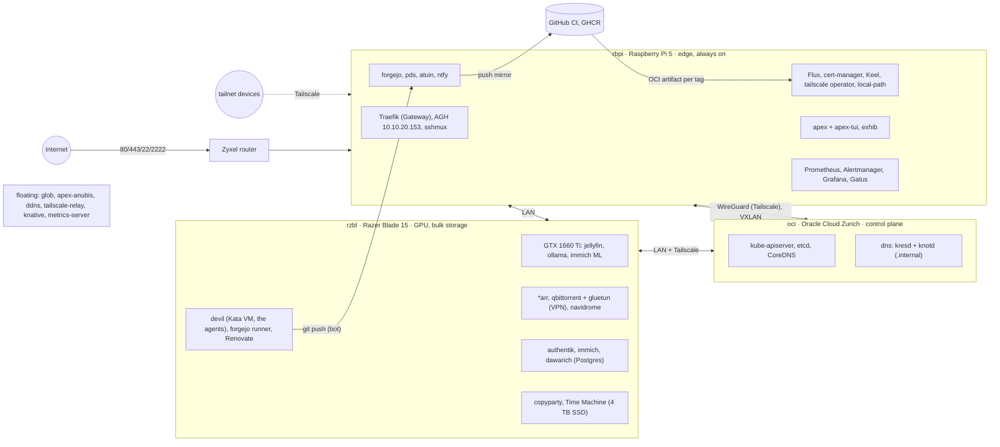

# Infra

## Summary

Hybrid Talos Linux Kubernetes cluster, managed by Flux from this repo. One
control plane in Oracle Cloud `eu-zurich-1` (oci), two workers at home: a
Raspberry Pi 5 (rbpi, the always-on edge) and a Razer Blade 15 (rzbl, GPU
and bulk storage). Hardware details: `docs/HARDWARE.md`. Agent and operator rules:
`AGENTS.md` (full notes per component: `docs/COMPONENTS.md`). Owner runbook: `docs/OPERATIONS.md`. Day-to-day use (sign-in, streaming, Rex, agents): `docs/GUIDE.md`. Interactive atlas:
`docs/web/index.html`.

### Infrastructure & Operations

- **CD & Automation:** Flux (OCI artifact per `v*` tag), Keel (tier-2 `:latest`), Renovate, Kustomize
- **Secrets Management:** SOPS + age
- **Backups:** k8up (restic) to Garage S3 on a friend's NAS. Blocked: the NAS refuses `3900`, so nothing is backed up yet.

### Network & Cluster

- **Networking & Ingress:** Cilium, Traefik (Gateway API), Tailscale, cert-manager + Cloudflare DNS-01
- **Identity:** authentik SSO at `auth.0xbf.ch`
- **Monitoring:** kube-prometheus-stack, metrics-server, Gatus, alerts to ntfy

### Applications

- **Public sites:** apex `0xbf.ch` (SSH TUI: `ssh -p 2222 0xbf.ch`), glob `blog.0xbf.ch`, exhib `gallery.0xbf.ch`
- **Public apps:** Forgejo `git.0xbf.ch` (git SSH on `22`), Jellyfin `videos.0xbf.ch`, Immich `photos.0xbf.ch`, copyparty `files.0xbf.ch`, atuin `atuin.0xbf.ch`, ATProto PDS `pds.0xbf.ch`, ntfy `notify.0xbf.ch`
- **Internal (`*.internal`):** *arr apps, qBittorrent (Proton VPN), Navidrome, Dawarich, Ollama, devil (dev VM, the agents run here), Grafana, Gatus, AdGuard Home
- **Platform:** knotd + kresd (`.internal` zone), DDNS, Time Machine (Samba), Forgejo Actions runner, Knative (tier-3 whims)

### Planned

- **Communication:** XMPP, Mumble
- **Mesh:** I2P, Yggdrasil, Reticulum, Meshtastic
- Projects: `ROADMAP.md`

### Where things run



Roles: oci runs only the control plane and DNS (tainted). rbpi is the edge: if it is down, nothing
public works anyway, so the cluster's own controllers live there too. rzbl does the heavy work;
it boots from a USB stick, so the cluster must not need it to heal. Monitoring sits on rbpi so it
can report a dead rzbl. Live view: `docs/web/index.html` (atlas).

### Repository Structure

```
.
├── README.md
├── ROADMAP.md
├── .sops.yaml                       # SOPS config (age public key)
│
├── talos/                          # Talos OS config (topf)
│   ├── topf.yaml                   # TOPF cluster definition; per-node schematicId
│   ├── schematic.<node>.yaml       # Image-factory schematics
│   ├── secrets.sops.yaml           # SOPS-encrypted cluster secrets
│   └── patches/                    # merged: all/ -> <role>/ -> node/<host>/
│       ├── all/                    # cluster-wide: hostname, tailscale, CNI
│       ├── control-plane/          # oci: install disk, network, certSANs
│       └── node/                   # per-host: 01-install, 02-network, 03-tailscale, 04-storage
│
└── kubernetes/                     # Flux GitOps Manifests
    ├── flux/                       # OCIRepository (semver) + root Kustomization
    ├── cluster/                    # crds.yaml, infrastructure.yaml, applications.yaml
    ├── infrastructure/             # platform: storage, network, ingress, egress,
    │                               # monitoring, backup, keel, knative, gpu, kata
    └── applications/               # one directory = one namespace (full list: docs/COMPONENTS.md, Layout)
```

### Network Model

Addressing follows `10.<location>.<function>.<host>` with `location = 10` for home and `location = 20` for cloud `eu-zurich-1`.

Function zones use decade-based third octets.

| Zone | Home subnet   | OCI subnet    | Purpose                           |
| ---- | ------------- | ------------- | --------------------------------- |
| 10   | 10.10.10.0/24 | 10.20.10.0/24 | Infrastructure, routers, DNS, VPN |
| 20   | 10.10.20.0/24 | 10.20.20.0/24 | Kubernetes nodes and compute      |
| 30   | 10.10.30.0/24 | 10.20.30.0/24 | Storage and internal services     |
| 40   | 10.10.40.0/24 | 10.20.40.0/24 | Trusted LAN devices               |
| 50   | 10.10.50.0/24 | 10.20.50.0/24 | IoT and smart-home devices        |
| 60   | 10.10.60.0/24 | 10.20.60.0/24 | Guest and DMZ workloads           |

### Current Stack

| Layer         | Component                                             | Version                         |
| ------------- | ----------------------------------------------------- | ------------------------------- |
| OS            | Talos Linux                                           | 1.14.6                          |
| Kubernetes    | API server / kubelet                                  | 1.37.2                          |
| GitOps        | Flux (source, kustomize, helm, notification)          | 2.9.5                           |
| CNI           | Cilium (kube-proxy replacement, LB-IPAM, L2 announce) | 1.20.2                          |
| Ingress       | Traefik via Gateway API                               | chart 41.6.0 (v3.7)             |
| Gateway API   | experimental channel CRDs (TCPRoute)                  | 1.6.2                           |
| Certificates  | cert-manager                                          | 1.21.2                          |
| Mesh / VPN    | Tailscale (operator + extension on nodes)             | 1.102.3                         |
| Monitoring    | kube-prometheus-stack, metrics-server, Gatus          | 91.4.1 / 3.14.0 / v5.36.0       |
| Backups       | k8up (restic to Garage S3)                            | chart 4.10.0 (operator v2.16.0) |
| Whim platform | Knative Serving via operator (scale-to-zero)          | 1.23.0 (operator 1.23.1)        |

### GitOps Delivery

Manifests are packaged as OCI artifact and published to `ghcr.io/bfeitknecht/infra` by GitHub Actions on every `v*` tag (tags are pushed to Forgejo; its push mirror carries them to GitHub). OCIRepository in `flux-system` tracks `semver >=1.0.0`. Push tag is the only deploy method. Cluster never reads working tree or plain git.

```
just release X.Y.Z                                # gates (check, fmt), tag, push; CI publishes
flux reconcile source oci flux-system             # pull immediately (optional)
flux reconcile kustomization flux-system          # apply immediately (optional)
```

### Kustomization Topology

```
cluster/crds.yaml            gateway-api-crds (v1.6.2), traefik-crds (v41.6.0),
                             prometheus-crds (91.4.1), k8up-crds (4.10.0), knative-operator-crds (v1.23.1)
                             pinned GitRepository sources, prune: false

cluster/infrastructure.yaml  storage -> cilium -> ipam
                             cilium -> cert-manager -> traefik -> tailscale
                             storage -> egress-tailscale -> backup (also k8up-crds)
                             knative-operator-crds -> knative-operator -> knative-serving
                             keel, monitoring (dependsOn prometheus-crds + traefik)
```

Dry-run validates all manifests in a Kustomization before apply. So CRs must not share Kustomization with HelmRelease that creates their CRDs. Cilium CRDs are created by operator at runtime (no upstream files). So LB pool and L2 policy are in separate `ipam` Kustomization that depends on `cilium`.

### Ingress & Certificates

- Traefik is Gateway API implementation (`gatewayClassName: traefik`). Gateway listeners use `8000/8443` plus TCP `22` for forgejo git-ssh, `2222` for the sshmux (apex TUI). The router forwards WAN `80/443/22/2222` to rbpi (Traefik hostPorts).
- Gateway address `10.10.20.128` is from Cilium LB-IPAM pool in `network/ipam`. It is L2-announced on worker `end0`.
- Public names `0xbf.ch` and `*.0xbf.ch` use Let's Encrypt wildcard via Cloudflare DNS-01.
- Internal names `*.internal` use cert-manager internal CA. Chain is selfsigned bootstrap to 10y CA (name-constrained to `.internal`) to 1y cert with explicit names. Let's Encrypt cannot issue for `internal`.
- Traefik dashboard is at `https://traefik.internal`. It is IngressRoute with LAN allowlist middleware.
- ATProto PDS is at `pds.0xbf.ch` (API) and `*.pds.0xbf.ch` (handle via `/.well-known/atproto-did`). Custom handles use DNS TXT.
- devil (Kata VM): no route at all. Tailscale SSH on its own tailnet node (`ssh bf@devil`), Rex on the node `deviler`. No sshd since 2026-11-24.

### Secrets

All secrets are SOPS-encrypted with age (`.sops.yaml`, files `*.sops.yaml`). Flux decrypts with the `sops-age` key. The full list is in `docs/COMPONENTS.md` (Secrets), plus the Talos secrets bundle and node Tailscale patch in `talos/`.

### Access

- `kubeconfig` at repo root and `talos/talosconfig` (both gitignored).
- Off-LAN access is over tailnet. Nodes run the Tailscale extension. rbpi advertises `10.10.10.0/24` and `10.10.20.0/24`, oci `10.20.20.0/24`, rzbl its own `/32`. The tailnet policy `autoApprovers` approves them.
- `traefik.internal` and all `*.internal` names resolve via DNS stack: AdGuard Home `10.10.20.153` (LAN-facing) to `resolver` pod on OCI (recursion + DNSSEC, ClusterIP `10.96.0.53`) to knotd for `internal.` (wildcard to `10.10.20.128`; explicit records for LAN devices like `router.internal` to `10.10.10.1`). LAN: router DHCP DNS to `10.10.20.153`. Off-LAN via Tailscale split DNS `internal.` to `10.10.20.153` (needs MagicDNS via advertised subnet routes).
